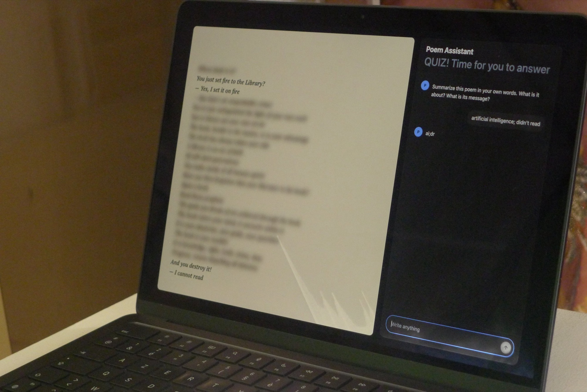
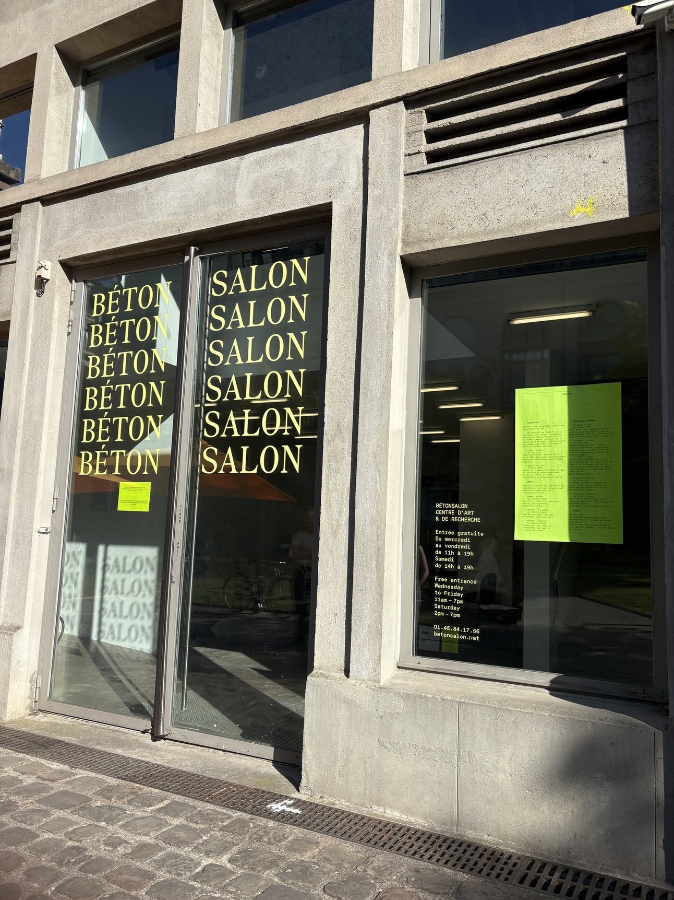
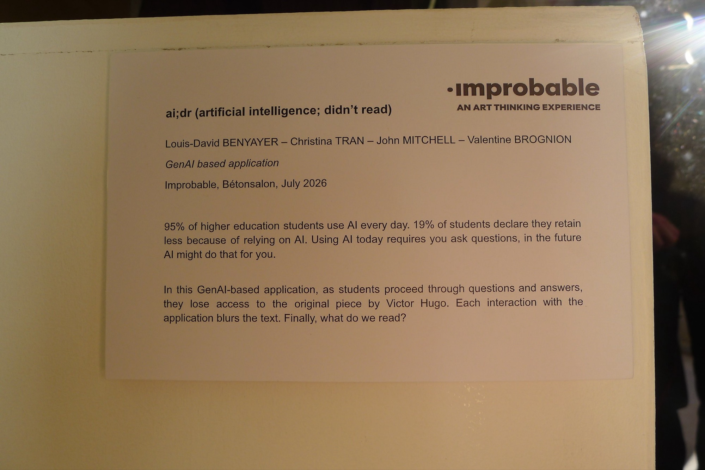
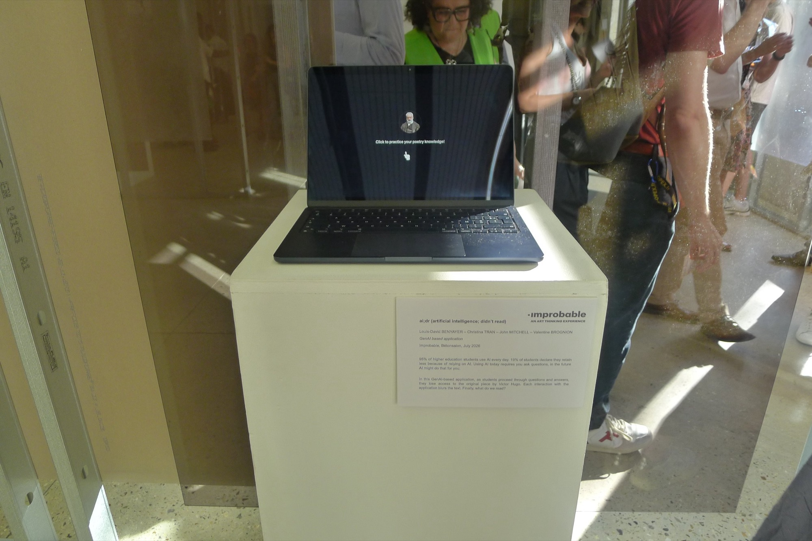
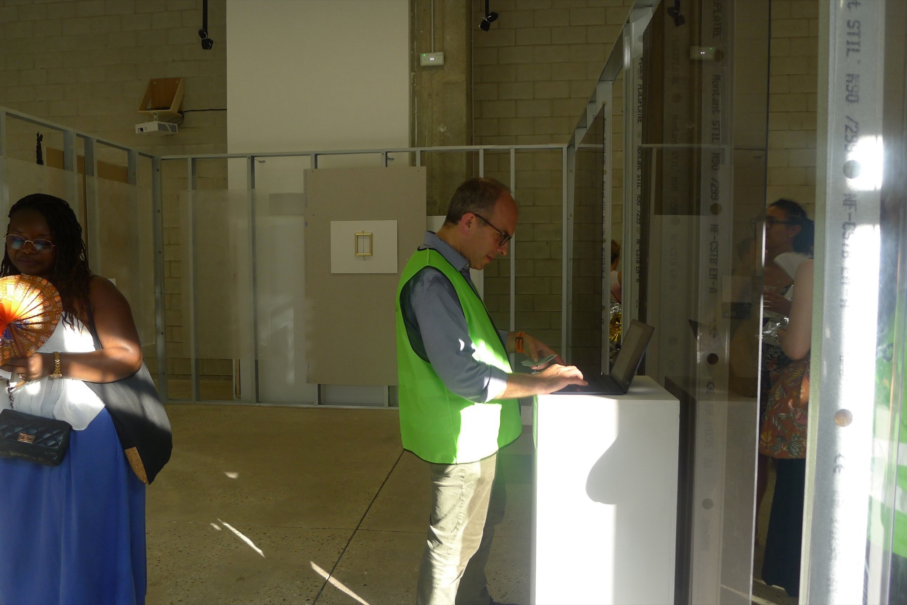
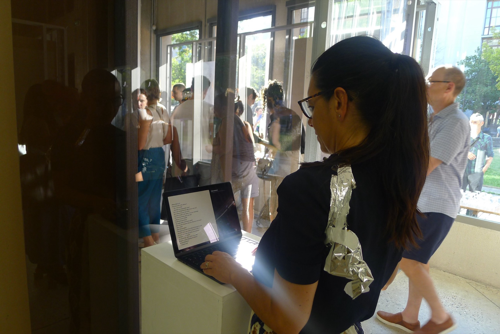

# ai;dr (artificial intelligence, didn't read)

I worked on this project for 2 days as part of the [improbable education seminar](/blog-post/improbable-seminar-recap), in collaboration with Louis-David Benyayer, John Mitchell, and Valentine Brognion.

It is about skill atrophy and reading comprehension from over-reliance on AI tools in education.

I find French contemporary art to be quite on-the-nose; it was interesting to collaborate with people on this.

<!-- break -->

<!-- break -->

<!-- break -->

<!-- break -->

<!-- break -->

