# jade moon automaton

for "Fabricating Mechanical Automatons" taught by Josh Corn

*\[work in progress\] more process documentation to come!*

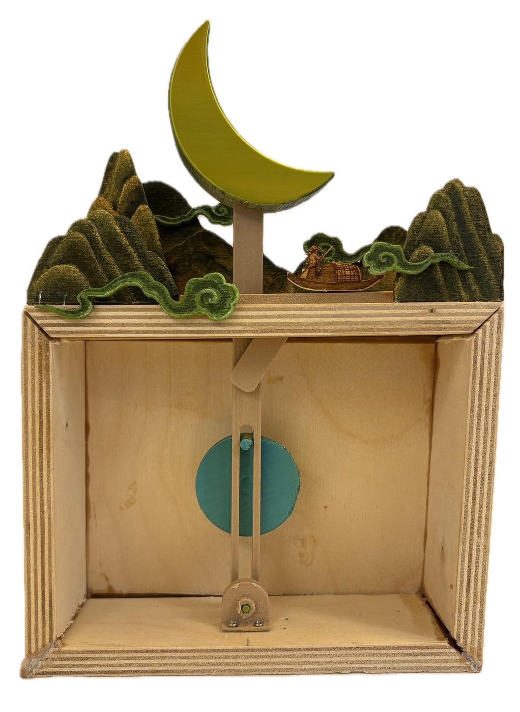

## inspiration

Hàn Mặc Tử's poems

- 'Đây Thôn Vĩ Dạ' ('Here in Vĩ Dạ Hamlet')
- 'Trăng vàng trăng ngọc' ('Golden Moon, Jade Moon')

Phương Mỹ Chi's 'Buôn Trang' ('Letting Go of the Moon'), a song that alludes to these two poems

read my [final project proposal](https://tunapee.online/2ndbrain/itp/automatons/week-3---final-project-proposal)

## process

3D-printed PLA - silk "jade" PLA and wood PLA

early concept drawings and CAD

<!-- break -->

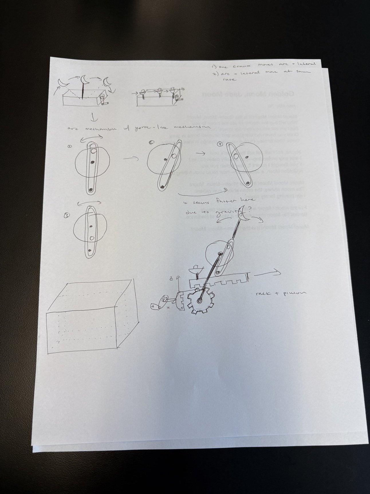

early prototypes

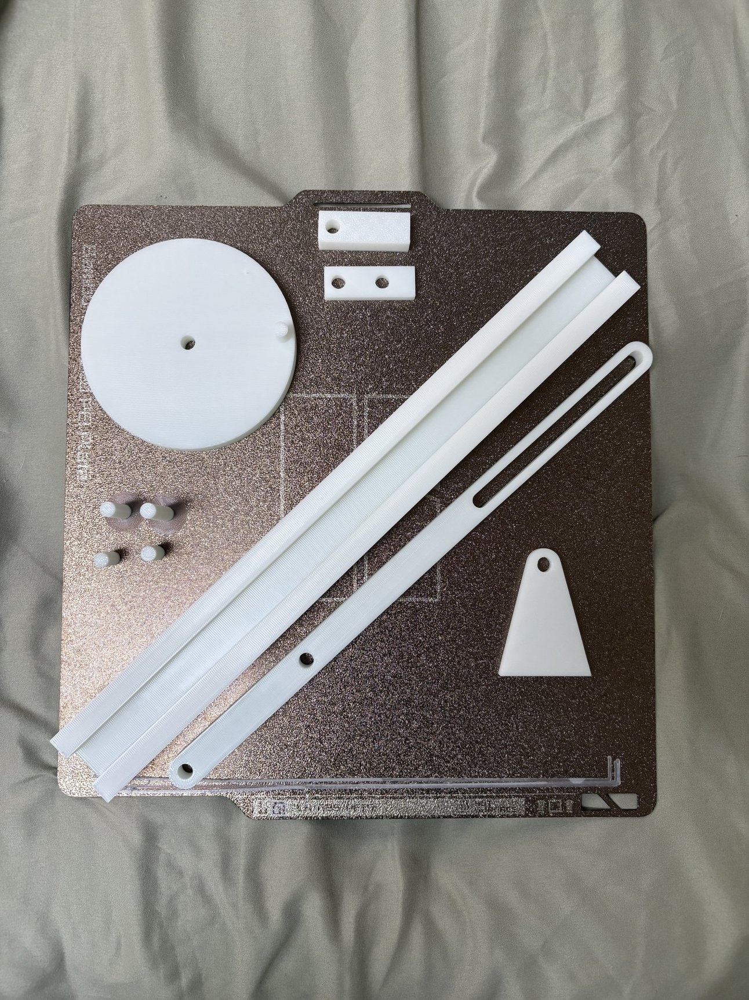

<!-- break -->

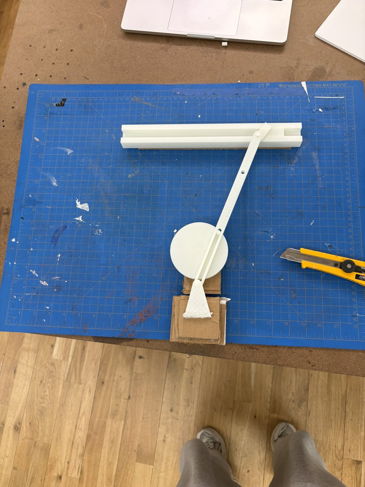

<!-- break -->

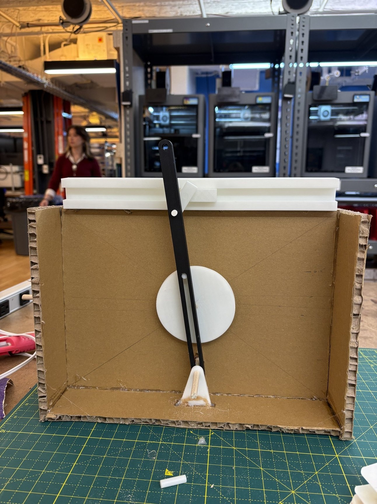

<!-- break -->

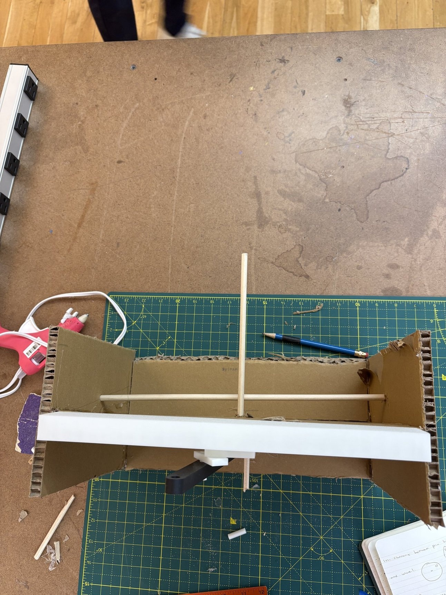

initially it was much larger scale

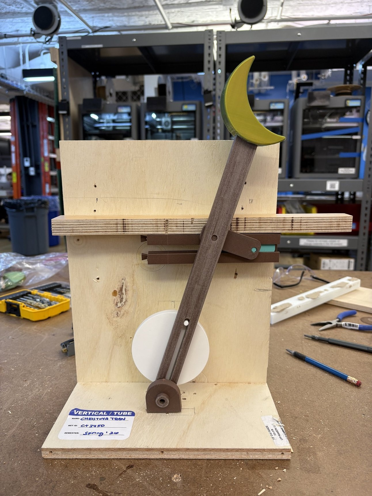

<!-- break -->

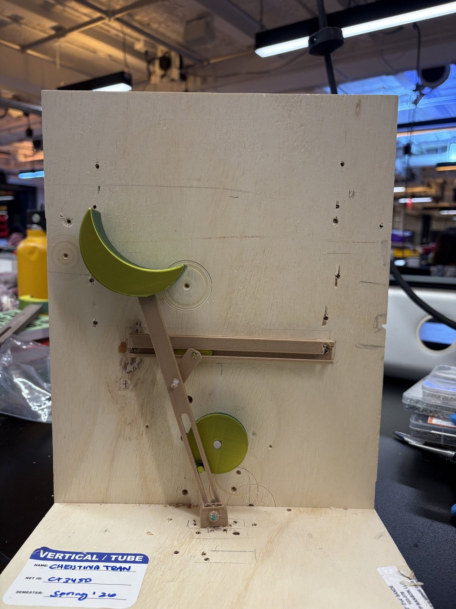

Laser-cut and painted these pieces with my friend Ashley's help

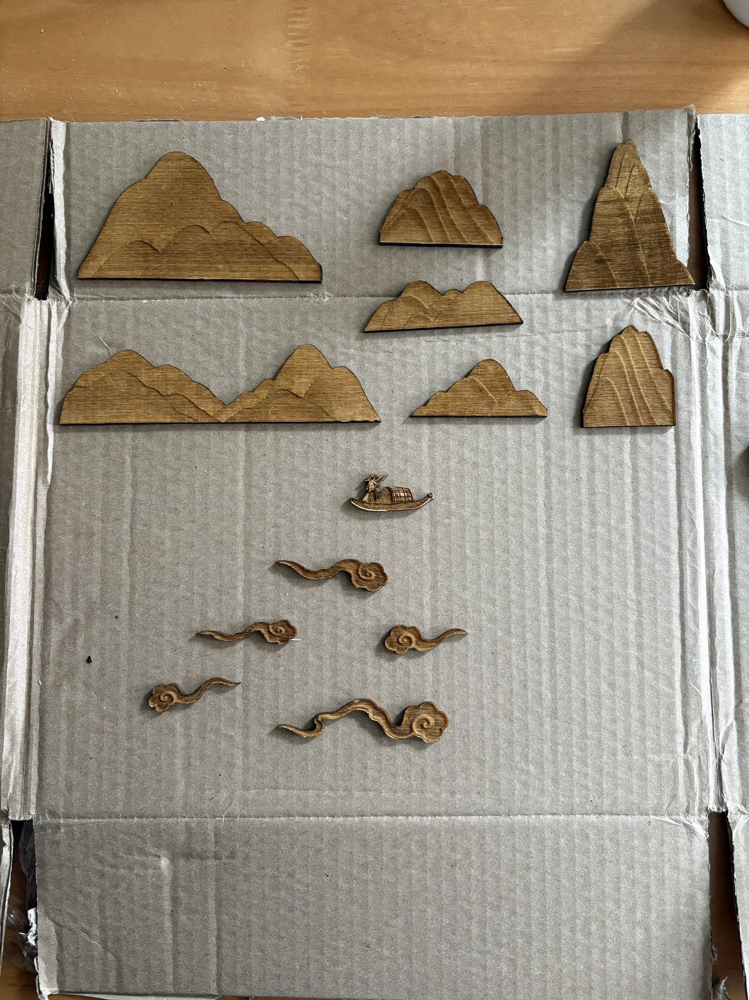

<!-- break -->

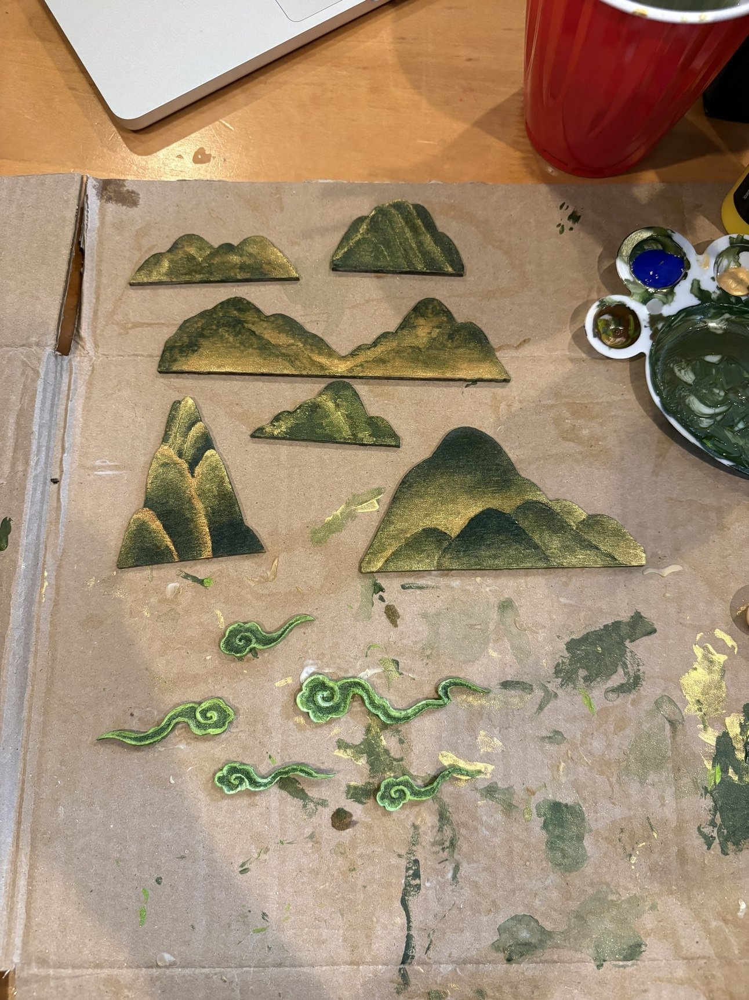

Attempted to make a mitred box using a track saw

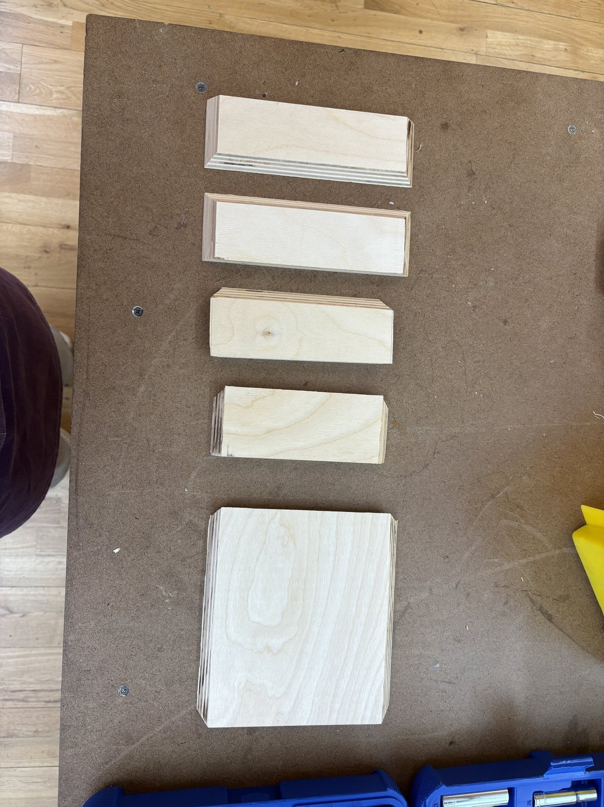

<!-- break -->

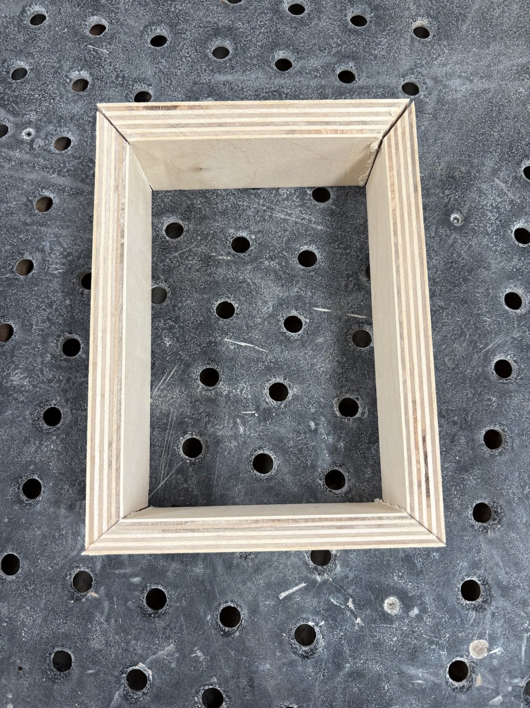

Messed up the cuts with the belt sander at a 45 degree angle, but with less precision

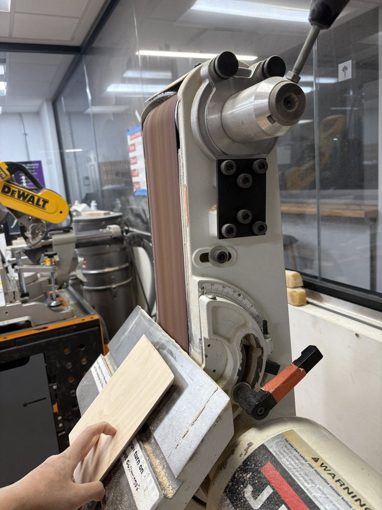

I want to redo and lacquer the box!!

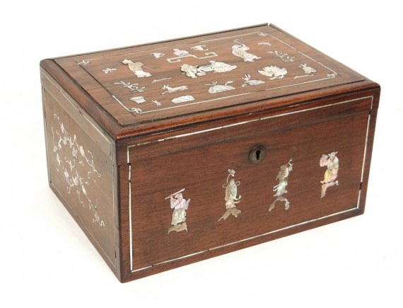
