# risograph printing explorations

## print 1: knockout

### results

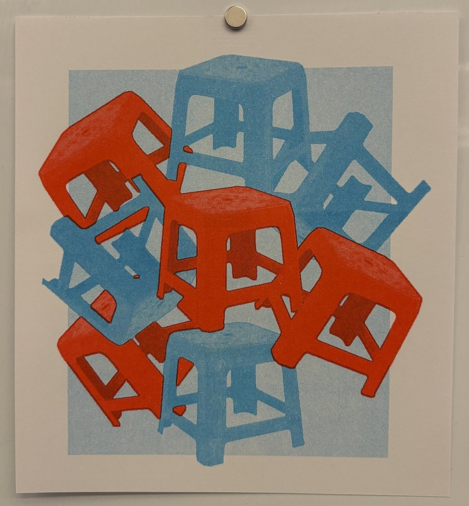

<!-- break -->

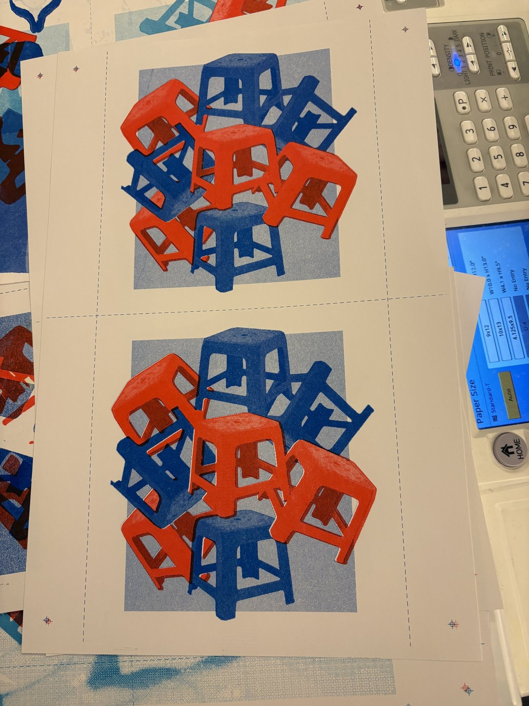

<!-- break -->

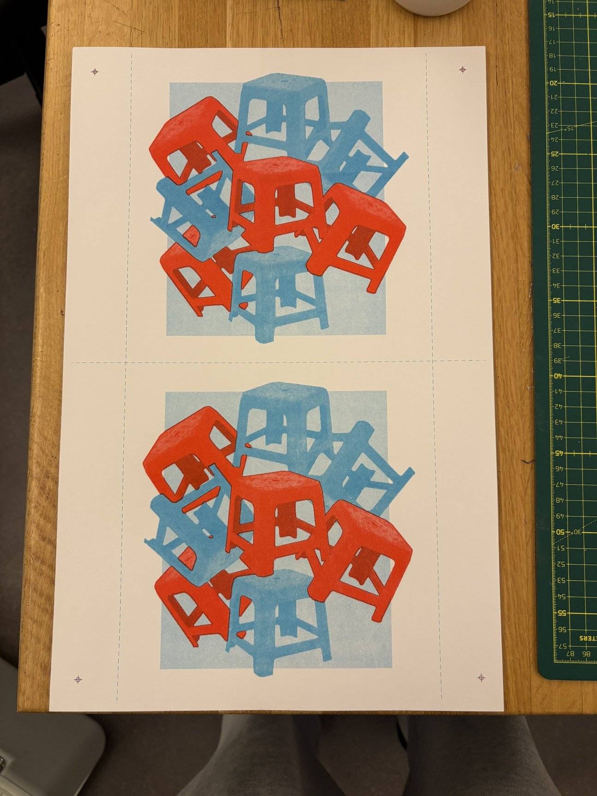

<!-- break -->

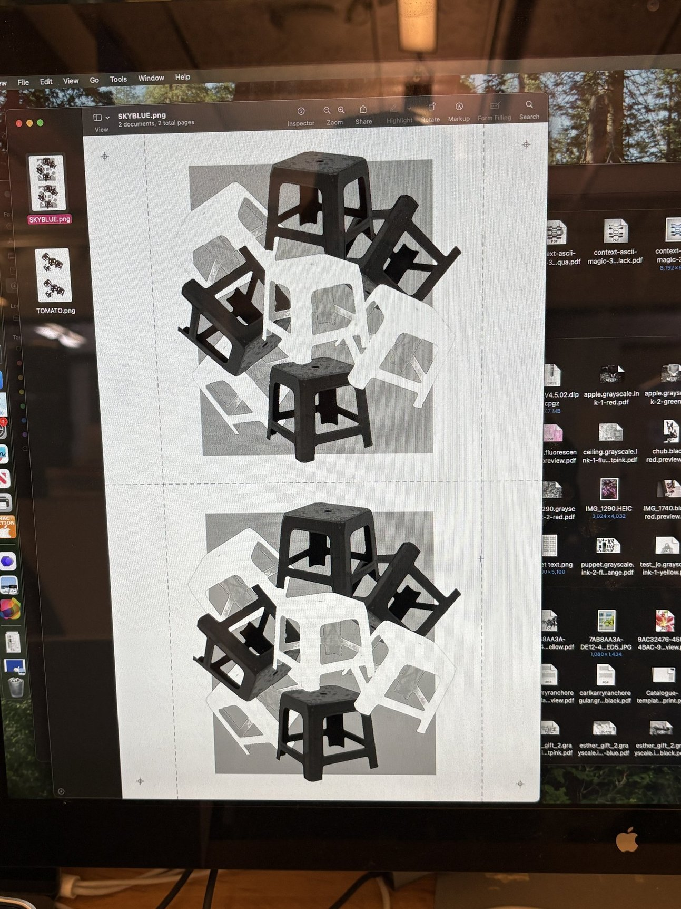

**preview**

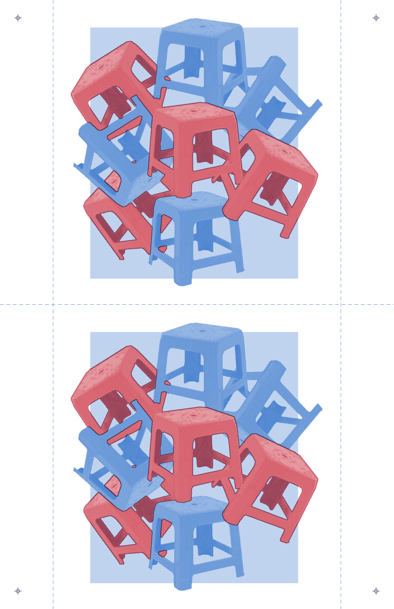

**red-only**

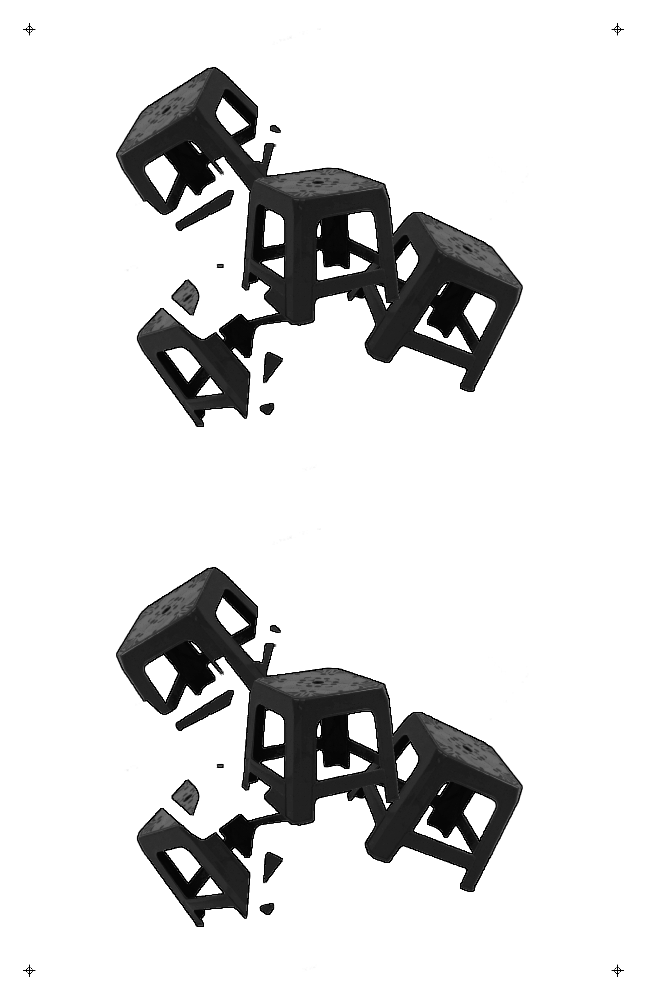

**blue-only**

some blue is kept to intentionally mix with the red and provide shading

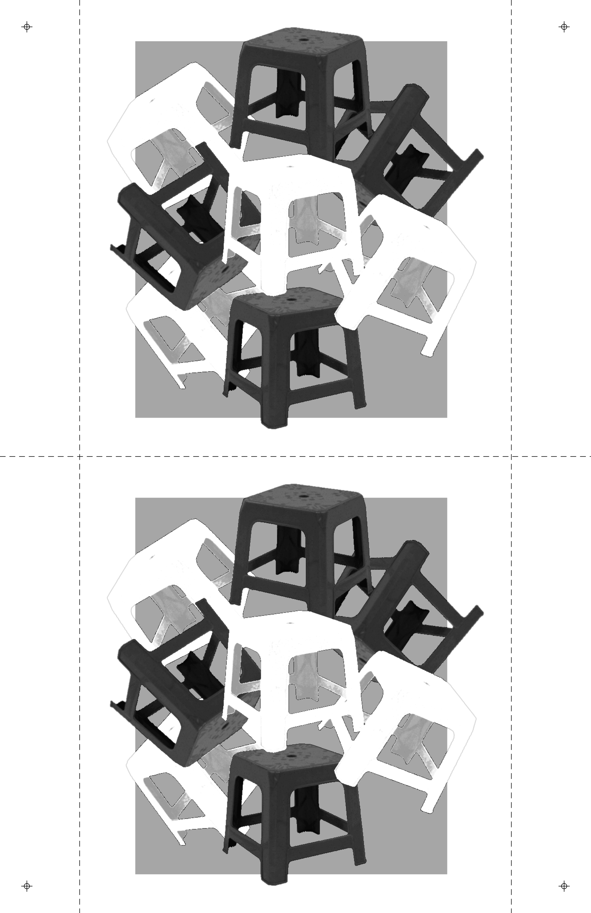

### code

- `p5.riso.js`
- `style.css`
- `index-v6-light-bg.html`
- `sketch-v6-light-bg.js`

## process

### questions

- doing this assignment makes me wonder why we're doing this programmatically. is there no existing good software to do this?

### ideas

- some guys house merch
- plastic stool
- automaton promo
- fishing rod diagram
- foldable den keo quan

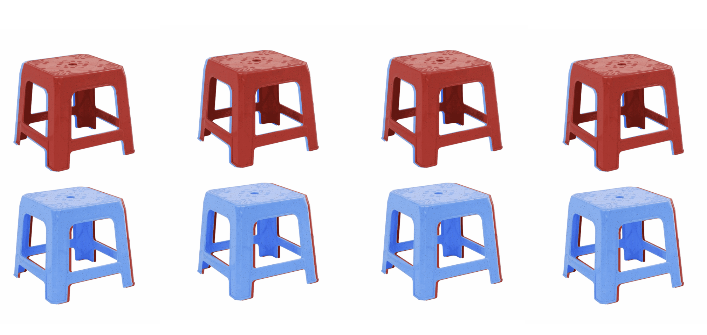

before the cutout/knockout step:

the brown-looking muddy red parts signify that there needs to be a cutout there so that the colors don't mix during printing

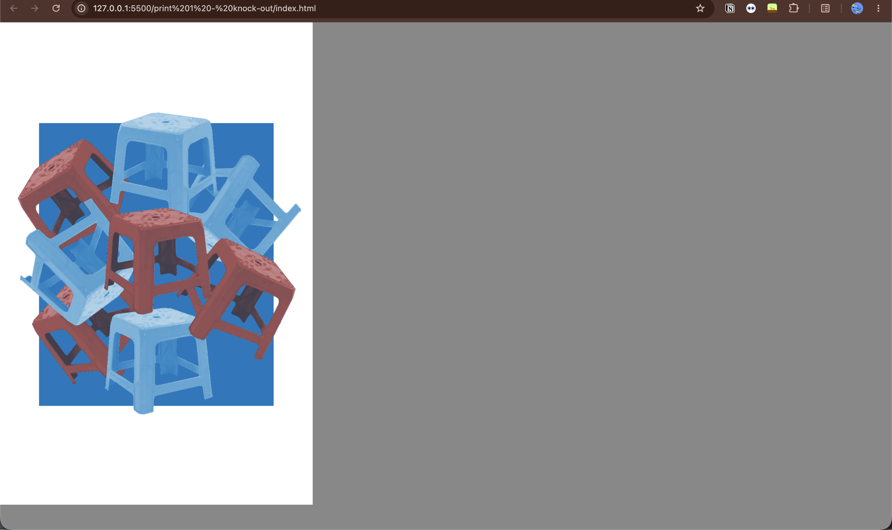

after blue knockout

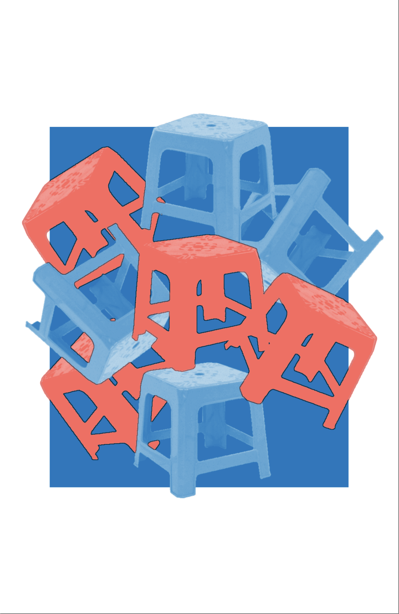

changed `RED` to `TOMATO` since it's closer to my desired color

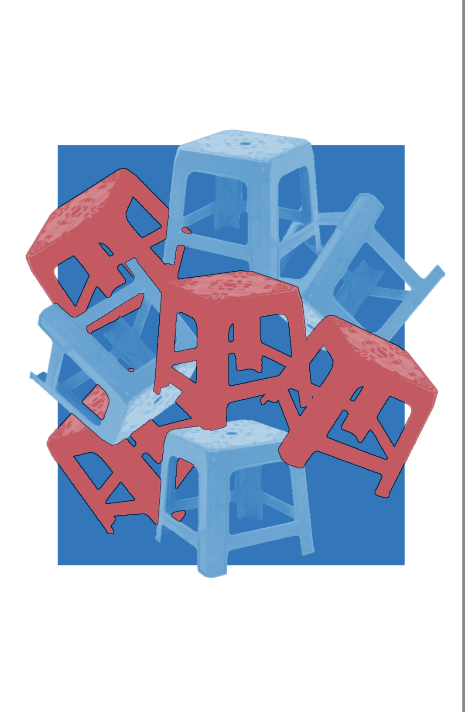

created registration marks and a slider to adjust color easily before export

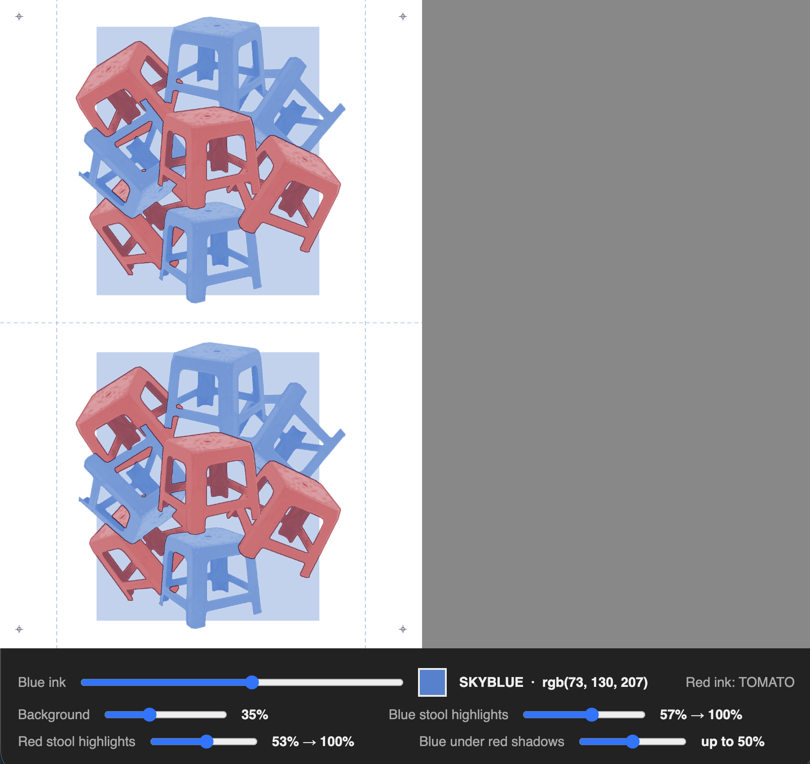
